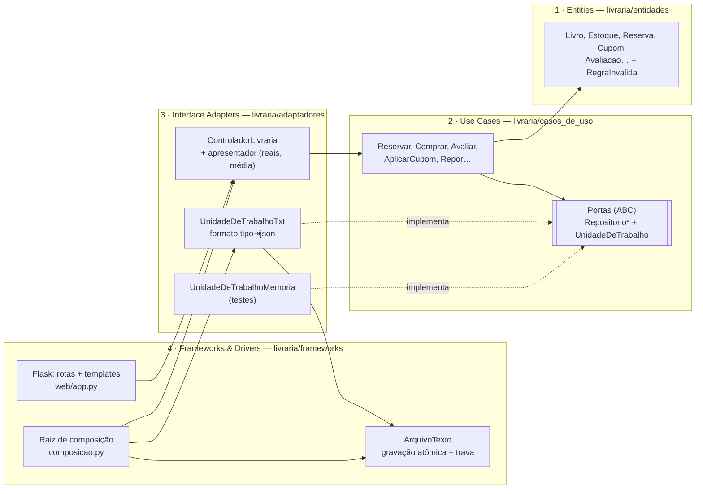

# Livraria — Exercício 7.4, Lab 07 (Arquitetura Clean)

Evolução da [livraria do exercício 6](https://github.com/HenriqueRSouza/livraria-sdd-exercicio-6) para **Arquitetura Clean**: o núcleo (entidades e casos de uso) não conhece Flask, arquivo nem formato de dados. A persistência agora é um **arquivo TXT** e o **Princípio da Inversão de Dependência (DIP)** permite trocar o armazenamento sem tocar no núcleo. A especificação continua sendo a fonte de verdade: [docs/specs/livraria.md](docs/specs/livraria.md) (R01–R08, C01–C10) e [docs/specs/tasks.md](docs/specs/tasks.md).

## Instalar e executar

Requer Python **3.10+** e pip. Na pasta do projeto:

```sh
python3 -m venv .venv
.venv/bin/python -m pip install -r requirements.txt
.venv/bin/python -m unittest discover -v
.venv/bin/python app.py
```

Abra **http://127.0.0.1:5000/**. Na primeira execução `livraria.txt` é criado com o catálogo de demonstração; execuções seguintes preservam cadastros e movimentações. Para recomeçar, apague `livraria.txt` com o servidor parado, ou use outro arquivo: `LIVRARIA_TXT=/caminho/outro.txt .venv/bin/python app.py`. `LIVRARIA_SECRET` define a chave de sessão.

## Os quatro anéis



| Anel | Pasta | Responsabilidade | Pode importar |
|---|---|---|---|
| 1 Entidades | `livraria/entidades` | Regras corporativas puras: débito de estoque, transições de reserva, preço promocional, cupom, pontos, validação de cadastro e avaliação | só stdlib básica |
| 2 Casos de uso | `livraria/casos_de_uso` | Um caso de uso por operação; **portas** abstratas de repositórios e `UnidadeDeTrabalho` | entidades, `abc`, `dataclasses` |
| 3 Adaptadores | `livraria/adaptadores` | `ControladorLivraria` e apresentador sem Flask; implementações das portas em memória e em TXT | entidades, casos de uso, stdlib (sem `os`/arquivo físico) |
| 4 Frameworks | `livraria/frameworks` | Flask, templates, driver `ArquivoTexto`, raiz de composição | tudo |

`tests/test_arquitetura.py` lê os imports com `ast` e falha se alguma dependência apontar para fora (por exemplo, `json` em casos de uso ou `flask` em adaptadores).

## DIP: núcleo independente de tecnologia

- **Abstrações no núcleo.** `livraria/casos_de_uso/portas.py` declara `RepositorioCatalogo`, `RepositorioLojas`, `RepositorioClientes`, `RepositorioPedidos`, `RepositorioCupons` e `UnidadeDeTrabalho`. Os casos de uso recebem uma `UnidadeDeTrabalho` no construtor e só falam com essas interfaces.
- **Detalhes nas bordas.** `adaptadores/persistencia/` implementa as portas duas vezes: `UnidadeDeTrabalhoTxt` (arquivo texto) e `UnidadeDeTrabalhoMemoria` (testes). O acesso físico ao disco é ainda mais externo: `frameworks/arquivo_texto.py`.
- **Ligação em um só lugar.** `frameworks/composicao.py` escolhe `UnidadeDeTrabalhoTxt(ArquivoTexto(caminho))` e entrega aos casos de uso. Trocar por SQLite, outro formato ou uma API exigiria só um novo adaptador e uma linha na composição.
- **Prova.** `test_dip_mesmo_nucleo_mesmo_resultado_em_memoria_e_txt` executa o mesmo roteiro nas duas implementações e compara os resultados; C01–C07, C09 e C10 rodam em memória, e os testes HTTP rodam em TXT.

A `UnidadeDeTrabalho` garante atomicidade: dentro de `with uow:` o caso de uso trabalha em uma cópia; somente `commit()` grava. Se uma regra falha no meio (sem estoque, cupom já usado), nada é gravado. O driver usa trava (`threading.RLock`) e grava em arquivo temporário + `os.replace`, para que o TXT nunca fique pela metade.

## Formato do arquivo TXT

Uma linha por registro: `<tipo><TAB><json do registro>`, em UTF-8 e legível em qualquer editor. Linhas iniciadas por `#` são comentários.

```text
# livraria — persistência TXT: uma linha por registro, <tipo><TAB><json>
livro	{"autor": "L. Andrade", "genero": "Ficção", "id": 1, "sinopse": "Uma viagem às memórias de uma cidade costeira.", "titulo": "A Casa das Marés"}
estoque	{"edicao_id": 1, "loja_id": 1, "quantidade": 0, "secao": "Literatura"}
cupom	{"ativo": true, "codigo": "LEITURA10", "descricao": "10% de desconto", "tipo": "percentual", "valor": 10}
avaliacao	{"autor": "Ana", "cliente_id": 1, "id": 2, "livro_id": 1, "nota": 4, "texto": "Muito bom"}
reserva	{"cliente_id": 1, "codigo": "RES-000001", "cupom": "LEITURA10", "edicao_id": 1, "estado": "confirmada", "id": 1, "loja_id": 1, "preco_centavos": 3600}
```

## Features adicionadas

- **Avaliações de clientes (R07/C09)** — no detalhe do livro, o cliente identificado dá nota 1–5 e comentário opcional (até 500 caracteres). Uma avaliação por cliente/livro; reenviar atualiza. O livro mostra média com uma casa decimal e quantidade; a área do cliente lista "Minhas avaliações".
- **Cupons de desconto (R08/C10)** — campo "Cupom" ao reservar ou comprar. `LEITURA10` dá 10% (arredondado para baixo) e `BEMVINDO5` dá R$ 5,00, sobre o preço já promocional e nunca negativo. Cada cliente usa cada cupom uma vez; cancelar a reserva libera o cupom. `ANTIGO20` é um cupom inativo para demonstrar a recusa. Reserva, compra e histórico mostram o cupom usado.

## O que mudou em relação ao exercício 6

| Exercício 6 | Exercício 7.4 |
|---|---|
| `livraria.py`: classe única com regras + SQL | Regras em `entidades`, orquestração em `casos_de_uso`, SQL eliminado |
| SQLite (`livraria.db`, `LIVRARIA_DB`) | Arquivo TXT (`livraria.txt`, `LIVRARIA_TXT`) via adaptador |
| Rotas Flask chamando o domínio diretamente | Rotas finas → `ControladorLivraria` (sem Flask) → casos de uso |
| Testes ligados ao SQLite | Casos de uso testados em memória; TXT e HTTP testados à parte; teste de arquitetura |
| Atomicidade por transação SQLite | Porta `UnidadeDeTrabalho` (commit/rollback) implementada pelos adaptadores |
| — | Avaliações de clientes e cupons de desconto |

## Percurso da interface

1. Catálogo → **A Casa das Marés**: compare edições, preços, promoção, estoque por loja e a média das avaliações.
2. **Cadastro / entrada** com interesse `Ficção`; veja recomendações e aviso de promoção em **Minha área**.
3. No livro, **avalie** (nota + comentário) e veja a média mudar; reenvie para atualizar.
4. Reserve na Unidade Centro com cupom `leitura10`: a confirmação mostra `RES-...`, R$ 36,00 e o cupom. Tente usar o mesmo cupom de novo para ver a recusa.
5. Em **Minha área**, retire com o código ou cancele (o cupom volta a ficar disponível). Compre direto com `BEMVINDO5`.
6. Para uma edição esgotada, peça aviso de reposição, clique **Simular +1 no estoque** e veja a notificação.
7. Abra `livraria.txt` para ver cada operação registrada em texto.

## Simulações e limites

- Pagamento, compra e retirada são registros locais, **sem cobrança real**; sessão identificada pelo email, sem senha. Busca por bairro é texto local, **sem GPS**.
- Notificações ficam no arquivo e na área do cliente, **sem email, push ou SMS**. Promoções, avaliações semente e cupons são dados de demonstração.
- O TXT é regravado inteiro a cada operação e protegido por trava de processo: adequado para a demonstração local com um servidor; não para vários processos simultâneos.

## Testes

```sh
.venv/bin/python -m unittest discover -v
```

| Arquivo | Cobre |
|---|---|
| `tests/test_casos_de_uso.py` | C01–C07 sobre o adaptador em memória, incluindo rollback em falha |
| `tests/test_avaliacoes_cupons.py` | C09 e C10 (regras de entidade e casos de uso) |
| `tests/test_persistencia_txt.py` | formato TXT, semente idempotente, persistência entre instâncias, arquivo intacto em falha, DIP memória × TXT |
| `tests/test_web.py` | C08–C10 via HTTP (Flask test client) com TXT temporário |
| `tests/test_arquitetura.py` | regra da dependência entre os anéis |
