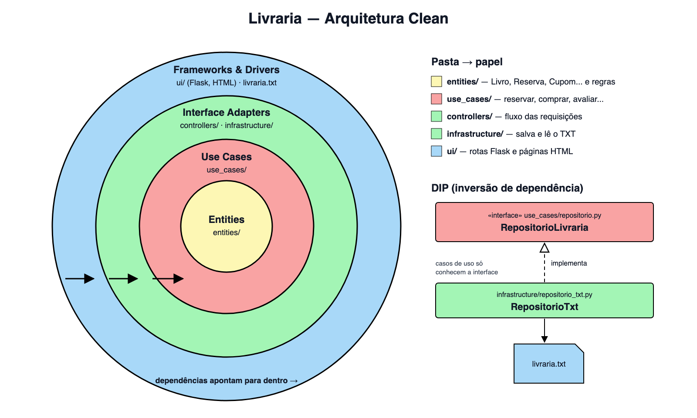

# Livraria — Exercício 7.4 (Arquitetura Clean)

Continuação da livraria do exercício 6, reorganizada em **Arquitetura Clean**. Agora os dados ficam salvos em um **arquivo TXT**, e o núcleo do sistema não depende dessa tecnologia (**DIP**).

## O que mudou

- O código foi separado nas camadas do slide: `entities`, `use_cases`, `controllers`, `infrastructure` e `ui`.
- Saiu o SQLite. Os dados agora ficam em `livraria.txt`.
- Os casos de uso usam só a interface `RepositorioLivraria`. A classe que grava no TXT fica na infraestrutura.
- As URLs e as regras do exercício 6 continuam iguais.

## Novas features

- **Avaliações de clientes:** nota de 1 a 5 e comentário opcional (até 500 caracteres). Cada cliente tem uma avaliação por livro e, se avaliar de novo, ela é atualizada. A página do livro mostra a média.
- **Cupons de desconto:** na reserva ou na compra direta. `LEITURA10` dá 10% e `BEMVINDO5` dá R$ 5,00. Cada cliente usa cada cupom uma vez; se cancelar a reserva, o cupom volta a valer.

## Arquitetura



```
app.py              -> monta tudo: RepositorioTxt -> casos de uso -> controller -> Flask
livraria/
  entities/         -> Livro, Edicao, Loja, Estoque, Cliente, Reserva, Compra, Avaliacao, Cupom...
  use_cases/        -> Catalogo, Clientes, Pedidos + repositorio.py (interface)
  controllers/      -> LivrariaController
  infrastructure/   -> RepositorioTxt + dados de exemplo
  ui/               -> rotas Flask + templates
tests/
```

| Camada (slide) | Pasta | O que faz |
|---|---|---|
| Entity | `entities/` | Entidades fundamentais e regras puras: preço com promoção, desconto do cupom, pontos, estados da reserva |
| Use cases | `use_cases/` | Lógica de negócio: buscar, reservar, comprar, avaliar, aplicar cupom... |
| Controllers | `controllers/` | Gerencia o fluxo das requisições: converte os dados do formulário, chama o caso de uso e devolve a mensagem |
| Infraestrutura | `infrastructure/` | Armazenamento e recuperação de dados no arquivo TXT |
| UI | `ui/` | Telas (Flask + HTML) |

As dependências só apontam para dentro: `ui → controllers → use_cases → entities`. A `infrastructure` também aponta para dentro, porque implementa a interface que está em `use_cases`.

## DIP (inversão de dependência)

Os casos de uso não sabem que existe um arquivo TXT. Eles recebem qualquer objeto que siga a interface:

```python
# use_cases/repositorio.py
class RepositorioLivraria(ABC):
    def listar(self, tipo): ...
    def salvar(self, registro): ...
    def remover(self, registro): ...
    def transacao(self): ...

# infrastructure/repositorio_txt.py
class RepositorioTxt(RepositorioLivraria): ...   # grava em livraria.txt
```

Para trocar o TXT por SQLite, por exemplo, basta criar outro repositório que implemente `RepositorioLivraria` e passá-lo no `app.py`. Entidades e casos de uso não mudam.

Exemplo do `livraria.txt` (uma linha por registro, `<tipo><TAB><json>`):

```
livro	{"autor": "L. Andrade", "genero": "Ficção", "id": 1, "sinopse": "...", "titulo": "A Casa das Marés"}
cupom	{"ativo": true, "codigo": "LEITURA10", "descricao": "10% de desconto", "tipo": "percentual", "valor": 10}
reserva	{"cliente_id": 1, "codigo": "RES-000001", "cupom": "LEITURA10", "edicao_id": 1, "estado": "confirmada", "id": 1, "loja_id": 2, "preco_centavos": 3600}
```

## Como rodar

Requer Python 3.10+.

```sh
python3 -m venv .venv
.venv/bin/python -m pip install -r requirements.txt
.venv/bin/python app.py
```

Abra http://127.0.0.1:5000/. Na primeira execução, o `livraria.txt` é criado com os dados de exemplo. Para usar outro arquivo: `LIVRARIA_TXT=outro.txt .venv/bin/python app.py`. Pagamento, retirada e avisos são apenas simulações locais.

## Testes

```sh
.venv/bin/python -m unittest discover -v
```

- `tests/test_casos_de_uso.py`: critérios C01–C07, mais C09 (avaliações) e C10 (cupons).
- `tests/test_repositorio_txt.py`: formato do arquivo, dados que continuam lá ao reabrir, e erro que não grava nada.
- `tests/test_web.py`: navegação pela interface (C08–C10).
